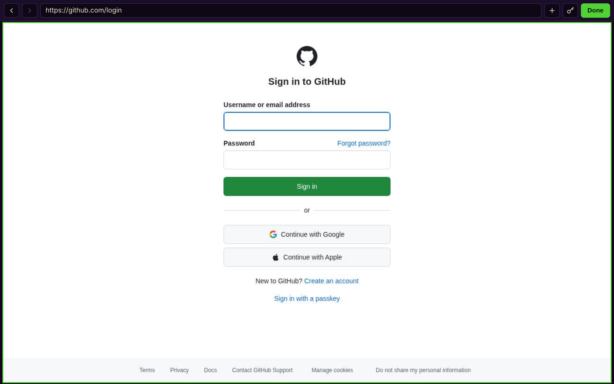

# browser-session-mcp

[](https://github.com/xav-ie/browser-session-mcp/actions/workflows/ci.yml)
[](https://github.com/xav-ie/browser-session-mcp/releases/latest)
[](LICENSE)
[](https://glama.ai/mcp/servers/xav-ie/browser-session-mcp)

**Give every AI agent its own real Chrome, one that keeps its logins, records
what the page did, and gets past bot checks.** browser-session-mcp is an MCP
server that hands each agent an isolated, long-lived browser session. When a
site needs a password or passkey, the agent sends you a link, you log in on a
live view of the page, and the agent carries on without ever seeing your
credentials.

<!-- diagram:architecture -->
<picture>
  <source media="(prefers-color-scheme: dark)" srcset="docs/diagrams/architecture-dark.svg">
  
</picture>
<!-- /diagram:architecture -->

- **A browser per agent.** Each session has its own cookies, storage and tabs.
  Run many agents side by side on one Chrome without them seeing each other.
- **Sessions that stick around.** A session is just an id the agent passes to
  each tool, so it survives dropped connections and server restarts.
- **Hand logins to a human.** For passwords, passkeys and 2FA, the agent sends
  you a link to a live view of the page. You log in, click Done, and the agent
  continues. Your credentials never reach it.
- **Log in once.** Save a session's cookies under a name and load them into any
  future session.
- **Everything recorded.** Every console message and network request is kept on
  disk, grouped by page visit, for the agent to read back while debugging.
- **Gets past bot checks.** No `Runtime.enable` tell, a consistent User-Agent
  and Client Hints, no injected scripts, and real mouse and keyboard input.
  Stealth can be switched on and off per session.
- **[31 tools](#all-31-tools)** for tabs, navigation, clicks and typing,
  screenshots, accessibility snapshots, logs and CPU profiles.

## Quick start

You need **a Chrome with its DevTools port open** (this server drives one, it
doesn't bundle one) and **an MCP client** such as Claude Code.

**1. Start Chrome.** Any Chrome or Chromium works. No Chrome around? Get a
small headless one with `npx @puppeteer/browsers install chrome-headless-shell`.

```sh
chrome-headless-shell --remote-debugging-port=9222 &
curl -s http://localhost:9222/json/version   # prints JSON when it's ready
```

**2. Add the server to your MCP client.** `STATE_DIR` is where it keeps
sessions, logs and saved logins. With Nix, there's nothing to install:

```sh
claude mcp add browser-session -e BROWSER_URL=http://localhost:9222 \
  -e STATE_DIR="$HOME/.local/state/browser-session-mcp" \
  -- nix run github:xav-ie/browser-session-mcp -- mcp
```

<details>
<summary><b>With Homebrew</b> (macOS on Apple silicon, or Linux)</summary>

```sh
brew install xav-ie/tap/browser-session-mcp

claude mcp add browser-session -e BROWSER_URL=http://localhost:9222 \
  -e STATE_DIR="$HOME/.local/state/browser-session-mcp" \
  -- browser-session mcp
```

</details>

<details>
<summary><b>Without Nix:</b> download a prebuilt binary</summary>

Each [release](https://github.com/xav-ie/browser-session-mcp/releases) has a
tarball per platform with the `browser-session` binary, the takeover page and
systemd units. The Linux binaries are static and run on any distribution; the
macOS one runs on Apple silicon with macOS 14 or newer.

```sh
ver=$(curl -fsSL https://api.github.com/repos/xav-ie/browser-session-mcp/releases/latest | sed -n 's/.*"tag_name": "\(.*\)".*/\1/p')
case "$(uname -sm)" in
  "Linux x86_64")  target=x86_64-unknown-linux-musl ;;
  "Linux aarch64") target=aarch64-unknown-linux-musl ;;
  "Darwin arm64")  target=aarch64-apple-darwin ;;
esac
base=https://github.com/xav-ie/browser-session-mcp/releases/download/$ver
curl -fsSLO "$base/browser-session-$ver-$target.tar.gz"
# check it (on macOS, use shasum -a 256 -c instead of sha256sum -c)
curl -fsSL "$base/SHA256SUMS" | grep "browser-session-$ver-$target.tar.gz" | sha256sum -c -
tar -xzf "browser-session-$ver-$target.tar.gz"

claude mcp add browser-session -e BROWSER_URL=http://localhost:9222 \
  -e STATE_DIR="$HOME/.local/state/browser-session-mcp" \
  -- "$PWD/browser-session-$ver-$target/browser-session" mcp
```

</details>

**3. Ask your agent to use it.**

> Open a browser session, go to example.com, and take a screenshot.

The agent calls `open_browser_session`, gets back a `sessionId`, and passes it
to every tool after that:

```ts
const { sessionId } = (await tools.browser_session_mcp.open_browser_session({})).structuredContent;
await tools.browser_session_mcp.navigate({ sessionId, url: "https://example.com" });
await tools.browser_session_mcp.take_screenshot({ sessionId });
```

That's all you need to start. The `mcp` role works on its own. Run the
`listener` too if you want console and network logs, the `reaper` to clean up
idle sessions, and `takeover` for human logins; [Deployment](docs/deployment.md)
shows how.

> [!TIP]
> On Claude Code, install the
> [browser-session plugin](plugin/README.md) for a `browser-session-navigator`
> agent that already knows how to drive these tools.

## Handing a login to a person

When a page needs credentials the agent must not see, it asks for a takeover
link and shows it to you. The page opens a live view of the agent's tab; you
log in there, click Done, and the agent picks up where it left off.



<!-- diagram:takeover -->
<picture>
  <source media="(prefers-color-scheme: dark)" srcset="docs/diagrams/takeover-dark.svg">
  
</picture>
<!-- /diagram:takeover -->

The link works for one browser only: the first to open it claims it, and it
expires after 30 minutes by default. [Workflows](docs/workflows.md#human-takeover)
has the details and the code.

## Picking elements with Jev

`take_snapshot` returns the page as text without element references, so
acting on it means writing CSS selectors by hand. With a
[Jev](https://typesafe.ai) key configured, the acting tools also accept
plain language: describe the element and the Jev decision model picks it.

```
click({ sessionId, selector: "the login button" })        ← plain words
click({ sessionId, selector: "jev: the login button" })   ← straight to Jev
type({ sessionId, selector: "the email field", text: "xavier@example.com" })
```

No syntax to remember: a selector is first used as CSS, and if it matches
nothing within `timeout` it is retried as a plain-language goal via Jev —
the automatic fallback, which also rescues mistyped CSS selectors when Jev
recognizes the intent. A `jev:` prefix skips the CSS step and goes straight
to Jev. Either way, the confirmation names the element that was picked.

Each Jev resolution extracts the page's interactive elements from the DOM
(in-viewport first, capped at 240 — Jev's Choice limit is 255), stamps them
with `data-jev-id` attributes, and sends one Choice request to TypeSafe's
API (~150–500ms, $0.042 per million input tokens — a fraction of a cent per
action). The chosen element is then clicked or typed into through the same
trusted-CDP paths as a CSS selector.

Jev only picks the element — it never generates text, coordinates or
scripts — and everything fails closed: with no key the fallback is simply
skipped and the original CSS error returned; an empty page, confidence
below the floor, or a malformed response is an error, not a guess.
Confidence is held to a higher bar on the automatic fallback
(`JEV_FALLBACK_MIN_CONFIDENCE`, default 0.85) than on explicit `jev:` goals
(`JEV_MIN_CONFIDENCE`, default 0.5): when the caller passed CSS that matched
nothing, a Jev guess should only act if it is clearly right. Elements are
chosen from the page as it is when the call runs; `wait_for` content first on
pages that are still loading (`wait_for` itself takes CSS selectors and text
only).

`act` runs the same machinery as a server-side loop for a whole goal: each
step is one Jev request that picks the next element — or a scroll/wait/back
action — and simultaneously judges whether the goal is met or the page is a
dead end (both gates at 0.85), so a multi-step flow costs seconds and
fractions of a cent instead of a driving-LLM round trip per click. Every
decision also sees the page's visible text (a modal's text first when one
is open), so goals can reference content that is not a button label.
Pass `values` for anything to type: Jev sees only their keys and picks which
field each belongs to in the same request that picks the element; the text
goes straight through CDP, never to a model. The loop verifies each action
had an effect (a fingerprint of URL, title, visible text and form state
moved), retries with Jev's next-best element
when one does not, and validates the probability distribution of every
answer. It returns a per-step trace and stops at `maxSteps` (default 8)
with a status: `completed`, `stuck`, `needs_login` (a sign-in wall — pair
it with `request_human_takeover` or `load_browser_state`; skipped when
`values` were passed, since then the caller supplied what to type), `blocked` (the
page showed an error), or `no_progress` (repeated actions had no visible
effect). It still fails closed — but Jev can be eager to call a goal met,
so verify the final page yourself.

Set `TYPESAFE_API_KEY` (from [console.typesafe.ai](https://console.typesafe.ai))
to enable it. `JEV_MODEL`, `JEV_BASE_URL`, `JEV_TIMEOUT_MS`,
`JEV_MIN_CONFIDENCE` and `JEV_FALLBACK_MIN_CONFIDENCE` tune it — see
[Deployment](docs/deployment.md#environment).

## All 31 tools

Most tools take a `sessionId` first. Tools marked ⚙ need one of the optional
background roles from [Deployment](docs/deployment.md).
Tools that return JSON declare its shape as an MCP `outputSchema`, so clients
can type their results.

| Group | Tools |
|---|---|
| Sessions | `open_browser_session`, `close_browser_session`, `list_browser_sessions` |
| Tabs | `new_page`, `list_pages`, `switch_tab`, `close_tab` |
| Navigation | `navigate` |
| Seeing the page | `take_screenshot`, `take_snapshot` (the accessibility tree as text) |
| Acting on it | `act`, `click`, `type`, `press_key`, `scroll`, `move_mouse`, `wait_for`, `evaluate` |
| Logs ⚙ | `list_visits`, `list_console_messages`, `list_network_requests` |
| Profiling | `start_profiling`, `stop_profiling` |
| Stealth | `set_stealth`, `get_stealth` |
| Human takeover ⚙ | `request_human_takeover`, `await_human_takeover` |
| Saved logins | `save_browser_state`, `load_browser_state`, `list_browser_states`, `delete_browser_state` |

<details>
<summary><b>Every tool with its arguments</b></summary>

**Sessions**
- `open_browser_session({ viewport?, useMobileUA? })` → `{ sessionId, pageCount, activeUrl }`
- `close_browser_session({ sessionId })`: safe to call twice
- `list_browser_sessions()`

**Tabs**
- `new_page({ sessionId, url? })`: opens a tab; later calls act on it
- `list_pages({ sessionId })`: in a stable order, the active tab marked `*`
- `switch_tab({ sessionId, tabIndex })`: makes a tab active and brings it to the front
- `close_tab({ sessionId, tabIndex })`

**Navigation**
- `navigate({ sessionId, url, timeout? })`: returns after the load event

**Seeing the page**
- `take_screenshot({ sessionId, fullPage? })`: a PNG
- `take_snapshot({ sessionId })`: the accessibility tree as indented text

**Acting on it** (real CDP input, not synthetic JavaScript events)
- `act({ sessionId, goal, values?, maxSteps? })` → `{ status, goal, steps, url, title }`: a Jev-driven loop toward a goal — click, type (from `values`), select, scroll, wait or back per step, checking goal-met, dead-end, login and error walls each round until it finishes, gets stuck or runs out of budget
- `click({ sessionId, selector | x,y, timeout? })`: `selector` may be plain language or a `jev:<goal>` — the Jev decision model picks the element (see [Picking elements with Jev](#picking-elements-with-jev))
- `type({ sessionId, selector, text, delay?, clear?, timeout? })`: `selector` may be plain language or a `jev:` goal; the text itself always comes from you
- `press_key({ sessionId, key, selector?, timeout? })`: `key` is a name (Enter, Tab, ArrowDown…) or a character; `selector` may be plain language or a `jev:` goal and is optional
- `scroll({ sessionId, deltaY?, deltaX?, x?, y? })`
- `move_mouse({ sessionId, x, y })`
- `wait_for({ sessionId, selector? | text?, timeout? })`: CSS selector or page text (no `jev:` here — it's a poll, not an action)
- `evaluate({ sessionId, expression, tabIndex? })`: runs JavaScript and returns the value

**Logs** ⚙ (written by the `listener` role)
- `list_visits({ sessionId })`: one entry per page visit, oldest first
- `list_console_messages({ sessionId, visit?, limit? })`: `limit` defaults to 500
- `list_network_requests({ sessionId, visit?, limit? })`: `limit` defaults to 500

**Profiling** (find the JavaScript behind a slow or hung page)
- `start_profiling({ sessionId, tabIndex?, samplingIntervalUs? })`: starts the V8 CPU profiler
- `stop_profiling({ sessionId, tabIndex?, top?, terminateAfterMs?, timeout? })`: saves a `.cpuprofile` (open it in DevTools or speedscope.app) under `$STATE_DIR/logs/<sessionId>/profiles/` and returns long tasks, the hottest functions and time per script. If the page is hung, its script is stopped after `terminateAfterMs` (default 5000) so the profile can be collected

**Stealth**
- `set_stealth({ sessionId, enabled })`
- `get_stealth({ sessionId })` → `{ stealth }`

**Human takeover** ⚙ (needs the `takeover` role and `TAKEOVER_BASE_URL`)
- `request_human_takeover({ sessionId, ttlMinutes? })` → `{ url, token, expiresAtMs }`: returns right away with a link
- `await_human_takeover({ token, timeout? })` → `{ completed }`: waits until the person clicks Done

**Saved logins**
- `save_browser_state({ sessionId, name })`
- `load_browser_state({ sessionId, name })`
- `list_browser_states()`
- `delete_browser_state({ name })`

</details>

## Learn more

- **[Workflows](docs/workflows.md):** handing a login to a person, and saving
  cookies to reuse.
- **[How it works](docs/how-it-works.md):** why a session outlives its
  connection, the four roles, how stealth works, and what's on disk.
- **[Deployment](docs/deployment.md):** building from source, the NixOS module,
  systemd without Nix, and every environment variable.
- **[Development](docs/development.md):** checks, diagrams and releases.

## License

[MIT](LICENSE)
