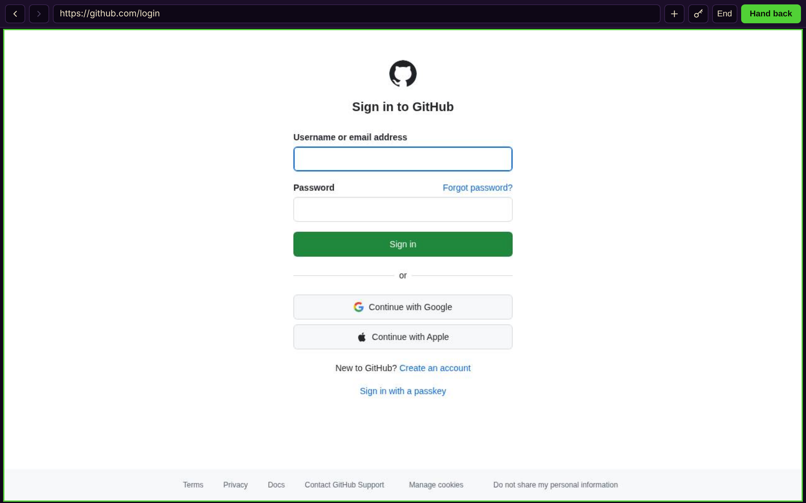
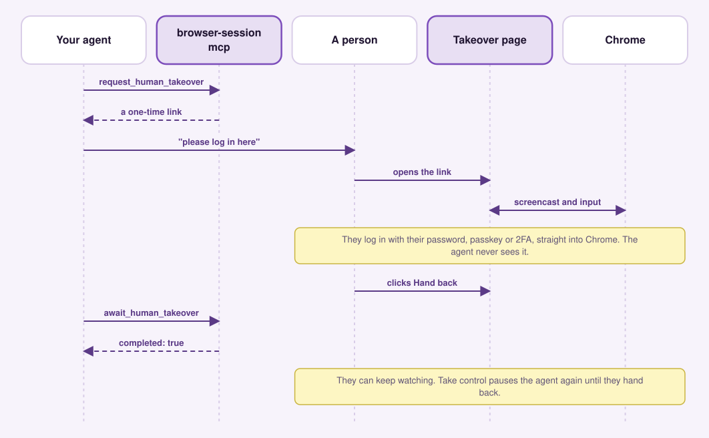

# browser-session-mcp

[](https://github.com/xav-ie/browser-session-mcp/actions/workflows/ci.yml)
[](https://github.com/xav-ie/browser-session-mcp/releases/latest)
[](LICENSE)
[](https://glama.ai/mcp/servers/xav-ie/browser-session-mcp)

**Give every AI agent its own real Chrome, one that keeps its logins, records
what the page did, and gets past bot checks.** browser-session-mcp is an MCP
server that hands each agent an isolated, long-lived browser session. When a
site needs a password or passkey, the agent sends you a link, you log in on a
live view of the page, and the agent carries on without ever seeing your
credentials.

<!-- diagram:architecture -->
<picture>
  <source media="(prefers-color-scheme: dark)" srcset="docs/diagrams/architecture-dark.svg">
  
</picture>
<!-- /diagram:architecture -->

- **A browser per agent.** Each session has its own cookies, storage and tabs.
  Run many agents side by side on one Chrome without them seeing each other.
- **Sessions that stick around.** A session is just an id the agent passes to
  each tool, so it survives dropped connections and server restarts.
- **Hand logins to a human.** For passwords, passkeys and 2FA, the agent sends
  you a link to a live view of the page. You log in, click Done, and the agent
  continues. Your credentials never reach it.
- **Log in once.** Save a session's cookies under a name and load them into any
  future session.
- **Everything recorded.** Every console message and network request is kept on
  disk, grouped by page visit, for the agent to read back while debugging.
- **Gets past bot checks.** No `Runtime.enable` tell, a consistent User-Agent
  and Client Hints, no injected scripts unless you add one, and real mouse and
  keyboard input. Stealth can be switched on and off per session.
- **Test like a slow phone.** Throttle a session's CPU and network, and run
  your own script before the page's to time what happens from the first byte.
- **[42 tools](#all-42-tools)** for tabs, navigation, clicks and typing,
  screenshots, accessibility snapshots, logs, page speed, CPU profiles and
  throttling.

## Quick start

You need **a Chrome with its DevTools port open** (this server drives one, it
doesn't bundle one) and **an MCP client** such as Claude Code.

**1. Start Chrome.** Any Chrome or Chromium works. No Chrome around? Get a
small headless one with `npx @puppeteer/browsers install chrome-headless-shell`.

```sh
chrome-headless-shell --remote-debugging-port=9222 &
curl -s http://localhost:9222/json/version   # prints JSON when it's ready
```

**2. Add the server to your MCP client.** `STATE_DIR` is where it keeps
sessions, logs and saved logins. With Nix, there's nothing to install:

```sh
claude mcp add browser-session -e BROWSER_URL=http://localhost:9222 \
  -e STATE_DIR="$HOME/.local/state/browser-session-mcp" \
  -- nix run github:xav-ie/browser-session-mcp -- mcp
```

<details>
<summary><b>With Homebrew</b> (macOS on Apple silicon, or Linux)</summary>

```sh
brew install xav-ie/tap/browser-session-mcp

claude mcp add browser-session -e BROWSER_URL=http://localhost:9222 \
  -e STATE_DIR="$HOME/.local/state/browser-session-mcp" \
  -- browser-session mcp
```

</details>

<details>
<summary><b>Without Nix:</b> download a prebuilt binary</summary>

Each [release](https://github.com/xav-ie/browser-session-mcp/releases) has a
tarball per platform with the `browser-session` binary, the takeover page and
systemd units. The Linux binaries are static and run on any distribution; the
macOS one runs on Apple silicon with macOS 14 or newer.

```sh
ver=$(curl -fsSL https://api.github.com/repos/xav-ie/browser-session-mcp/releases/latest | sed -n 's/.*"tag_name": "\(.*\)".*/\1/p')
case "$(uname -sm)" in
  "Linux x86_64")  target=x86_64-unknown-linux-musl ;;
  "Linux aarch64") target=aarch64-unknown-linux-musl ;;
  "Darwin arm64")  target=aarch64-apple-darwin ;;
esac
base=https://github.com/xav-ie/browser-session-mcp/releases/download/$ver
curl -fsSLO "$base/browser-session-$ver-$target.tar.gz"
# check it (on macOS, use shasum -a 256 -c instead of sha256sum -c)
curl -fsSL "$base/SHA256SUMS" | grep "browser-session-$ver-$target.tar.gz" | sha256sum -c -
tar -xzf "browser-session-$ver-$target.tar.gz"

claude mcp add browser-session -e BROWSER_URL=http://localhost:9222 \
  -e STATE_DIR="$HOME/.local/state/browser-session-mcp" \
  -- "$PWD/browser-session-$ver-$target/browser-session" mcp
```

</details>

**3. Ask your agent to use it.**

> Open a browser session, go to example.com, and take a screenshot.

The agent calls `open_browser_session`, gets back a `sessionId`, and passes it
to every tool after that:

```ts
const { sessionId } = (await tools.browser_session_mcp.open_browser_session({})).structuredContent;
await tools.browser_session_mcp.navigate({ sessionId, url: "https://example.com" });
await tools.browser_session_mcp.take_screenshot({ sessionId });
```

That's all you need to start. The `mcp` role works on its own. Run the
`listener` too if you want console and network logs, the `reaper` to clean up
idle sessions, and `takeover` for human logins; [Deployment](docs/deployment.md)
shows how.

> [!TIP]
> On Claude Code, install the
> [browser-session plugin](plugin/README.md) for a `browser-session-navigator`
> agent that already knows how to drive these tools.

## Handing a login to a person

When a page needs credentials the agent must not see, it asks for a takeover
link and shows it to you. The page opens a live view of the agent's tab; you
log in there, click Done, and the agent picks up where it left off.



<!-- diagram:takeover -->
<picture>
  <source media="(prefers-color-scheme: dark)" srcset="docs/diagrams/takeover-dark.svg">
  
</picture>
<!-- /diagram:takeover -->

The link works for one browser only: the first to open it claims it, and it
expires after 30 minutes by default. [Workflows](docs/workflows.md#human-takeover)
has the details and the code.

## Picking elements with Jev


Set `TYPESAFE_API_KEY` and agents stop writing CSS selectors. Describe the
element in plain words and [Jev](https://typesafe.ai), a small decision model,
picks it in a few hundred milliseconds for a fraction of a cent, instead of a
large model reading the whole page to name a selector.

```
click({ sessionId, selector: "the login button" })
type({ sessionId, selector: "the email field", text: "me@example.com" })
act({ sessionId, goal: "add the cheapest oolong to the cart" })
ask({ sessionId, question: "Is the oolong in the cart?" })
read({ sessionId, question: "What is the return policy?" })
```

A selector is tried as CSS first, so nothing changes for agents that already
write CSS. `act` runs a whole multi step goal on the server, one Jev call per
step, and reports whether it finished, got stuck or hit a login wall. `ask`
answers a yes/no or multiple choice question about the page, and `read`
returns only the parts of a long page that answer a question. Text to
type stays out of the model, and every miss is an error, never a guess.
[Picking elements with Jev](docs/jev.md) covers the benefits, what Jev sees,
and tuning.

## All 42 tools

Most tools take a `sessionId` first. Tools marked ⚙ need one of the optional
background roles from [Deployment](docs/deployment.md).
Tools that return JSON declare its shape as an MCP `outputSchema`, so clients
can type their results. One call drives a session at a time: a second call on
the same session, from any client, waits up to 15 s for the first to finish.
Every tab answers the page's own dialogs (`alert`, `confirm`, `prompt`,
"Leave site?") by accepting them, reported in the next action's result, and
turns passkey prompts down, so sites fall back to a password or a code.

| Group | Tools |
|---|---|
| Sessions | `open_browser_session`, `close_browser_session`, `list_browser_sessions` |
| Tabs | `new_page`, `list_pages`, `switch_tab`, `close_tab` |
| Navigation | `navigate` |
| Seeing the page | `take_screenshot`, `take_snapshot` (the accessibility tree as text), `ask`, `read` |
| Acting on it | `act`, `click`, `tap`, `swipe`, `type`, `select_option`, `upload_file`, `press_key`, `scroll`, `move_mouse`, `wait_for`, `evaluate` |
| Logs ⚙ | `list_visits`, `list_console_messages`, `list_network_requests` |
| Page speed and profiling | `measure_page`, `start_profiling`, `stop_profiling` |
| Stealth | `set_stealth`, `get_stealth` |
| Slow devices ⚙ | `set_emulation`, `get_emulation`, `add_init_script`, `remove_init_script` |
| Human takeover ⚙ | `request_human_takeover`, `await_human_takeover` |
| Saved logins | `save_browser_state`, `load_browser_state`, `list_browser_states`, `delete_browser_state` |

<details>
<summary><b>Every tool with its arguments</b></summary>

**Sessions**
- `open_browser_session({ device?, viewport?, useMobileUA?, userAgent?, name? })` → `{ sessionId, pageCount, activeUrl }`: `device` is a preset (`pixel-7`, `galaxy-s23`, `iphone-15`, `iphone-se`, `ipad-air`, `laptop`, `desktop-1080p`) setting the screen, pixel ratio, User-Agent and touch; `useMobileUA` makes it a touch phone (mobile UA, device metrics and a touch screen); `viewport.deviceScaleFactor` sets the pixel ratio and `userAgent` replaces the User-Agent, overriding a preset's; `name` reuses the open session with that name, or opens one with the login saved under it, and saves its login when a takeover finishes and when it closes
- `close_browser_session({ sessionId })`: safe to call twice; a named session saves its login first
- `list_browser_sessions()`

**Tabs**
- `new_page({ sessionId, url? })`: opens a tab; later calls act on it
- `list_pages({ sessionId })`: in a stable order, the active tab marked `*`
- `switch_tab({ sessionId, tabIndex })`: makes a tab active and brings it to the front
- `close_tab({ sessionId, tabIndex })`

**Navigation**
- `navigate({ sessionId, url, timeout?, waitUntil?, text?, settleTimeout? })`: returns after the load event, or with `waitUntil: "networkidle"` once requests go quiet, or once `text` shows, for pages that render themselves after loading

**Seeing the page**
- `take_screenshot({ sessionId, fullPage?, selector?, scale?, save? })`: a PNG of the screen, the whole page or one element; `save` writes it under `$STATE_DIR/screenshots/<sessionId>/`, kept after the session closes, and returns `{ path, bytes }` instead, for callers that can't take an image
- `take_snapshot({ sessionId })`: the accessibility tree as indented text
- `ask({ sessionId, question, options? })` → `{ answer, probability, probabilities? }`: asks Jev about the page as it is now, yes/no or which of your `options` fits, in one cheap call
- `read({ sessionId, question, maxChars? })` → `{ text, pageChars, passages, kept, filtered }`: only the passages of the page that help answer `question`, under their headings; a page under 8,000 characters comes back whole

**Acting on it** (real CDP input, not synthetic JavaScript events)
- `act({ sessionId, goal, values?, maxSteps? })` → `{ status, goal, steps, url, title }`: a Jev-driven loop toward a goal — click, type (from `values`), select, scroll, wait or back per step, checking goal-met, dead-end, login and error walls each round until it finishes, gets stuck or runs out of budget
- `click({ sessionId, selector | x,y, timeout? })` → `{ url, title, navigated, focused, dialog?, hit }`: `selector` may be plain language or a `jev:<goal>` — the Jev decision model picks the element (see [Picking elements with Jev](docs/jev.md)). Fails, naming the element in the way, when a popup or overlay covers the target or the point is off the screen, and otherwise says where the page is after: its URL, whether it navigated, the focused element and an open dialog. `tap`, `swipe` and `press_key` report the same
- `tap({ sessionId, selector | x,y, timeout? })`: a finger tap (touch events), for mobile sessions
- `swipe({ sessionId, selector? | x,y?, direction? | toX,toY, distance?, durationMs? })`: a finger swipe, e.g. to close a drawer or move a carousel; short and slow drags partway
- `type({ sessionId, selector, text, delay?, clear?, timeout? })`: `selector` may be plain language or a `jev:` goal; the text itself always comes from you, typed after what the field holds unless `clear`
- `select_option({ sessionId, selector, option?, timeout? })` → `{ chosen, options, shown, confirmed, ... }`: picks an option by its text in a native `<select>` or a dropdown drawn by scripts, with or without ARIA roles, in frames too (it opens it, types to filter only lists that may be partial, clicks the option and reads the field back); without `option` it lists the options and closes the list, choosing nothing; fails listing the options when none matches
- `upload_file({ sessionId, selector, content?, name?, path?, mimeType?, timeout? })` → `{ name, bytes, how, into, pageShowsName, ... }`: attaches a file given as base64 `content` (or a `path` on the server's machine) to a file input, or to the hidden one behind an Attach button or label; an element with no input behind it gets the file dropped on it
- `press_key({ sessionId, key, selector?, repeat?, timeout? })`: `key` is a name (Enter, Tab, ArrowDown…) or a character; `selector` may be plain language or a `jev:` goal and is optional; `repeat` presses it up to 50 times, with `focusTrail` listing focus after each press; `click`, `tap` and `press_key` list a dropdown's `options` when the action leaves one open
- `scroll({ sessionId, deltaY?, deltaX?, x?, y? })`
- `move_mouse({ sessionId, x, y })`
- `wait_for({ sessionId, selector? | text? | expression? | ms?, timeout? })`: a CSS selector, page text or a JavaScript expression turning truthy (no `jev:` here — it's a poll, not an action); `ms` alone just pauses, for hosts with no timer
- `evaluate({ sessionId, expression, tabIndex? })`: runs JavaScript and returns the value

**Logs** ⚙ (written by the `listener` role)
- `list_visits({ sessionId })`: one entry per page visit, oldest first
- `list_console_messages({ sessionId, visit?, limit? })`: `limit` defaults to 500
- `list_network_requests({ sessionId, visit?, limit?, urlContains?, details? })`: `limit` defaults to 500; `details` adds request and response headers and small text or JSON response bodies (fetch/XHR and documents, up to 64 KB), credential headers and keys masked and nothing kept from a takeover login. Includes requests from cross-site iframes and workers (sandboxed third-party code such as a checkout page's tracking pixels), logged under the tab's visit

**Page speed and profiling**
- `measure_page({ sessionId, url?, timeout? })`: reloads (or loads `url`) and returns server response, first and largest paint, layout shift, blocking time, and bytes by type and host, rated by the Core Web Vitals thresholds, in the session's device and throttling

Find the JavaScript behind a slow or hung page:
- `start_profiling({ sessionId, tabIndex?, samplingIntervalUs? })`: starts the V8 CPU profiler
- `stop_profiling({ sessionId, tabIndex?, top?, terminateAfterMs?, timeout? })`: saves a `.cpuprofile` (open it in DevTools or speedscope.app) under `$STATE_DIR/logs/<sessionId>/profiles/` and returns long tasks, the hottest functions and time per script. If the page is hung, its script is stopped after `terminateAfterMs` (default 5000) so the profile can be collected

**Stealth**
- `set_stealth({ sessionId, enabled })`
- `get_stealth({ sessionId })` → `{ stealth }`

**Slow devices** ⚙ (applied by the `listener` role to every tab of the session, including ones opened later)
- `set_emulation({ sessionId, cpuThrottlingRate?, network? })` → `{ cpuThrottlingRate, network, initScripts }`: CPU slowdown (1 to 100) and network throttling, a DevTools preset (`slow3g`, `slow4g`, `fast4g`, `offline`, `off`) or `{ latencyMs, downloadKbps, uploadKbps }`; in place on every open tab when it returns
- `get_emulation({ sessionId })` → `{ cpuThrottlingRate, network, initScripts }`
- `add_init_script({ sessionId, source })` → `{ id, ... }`: runs `source` in the main world at the start of every page load, before the page's own scripts, from each tab's next navigation
- `remove_init_script({ sessionId, id })`

**Human takeover** ⚙ (needs the `takeover` role and `TAKEOVER_BASE_URL`)
- `request_human_takeover({ sessionId, ttlMinutes? })` → `{ url, token, expiresAtMs }`: returns right away with a link
- `await_human_takeover({ token, timeout? })` → `{ completed, expired, url?, title? }`: waits up to `timeout` (default 25 s) for the person to click Done; call it in a loop until `completed`, or until `expired` says to request a new link

**Saved logins**
- `save_browser_state({ sessionId, name })`
- `load_browser_state({ sessionId, name })`
- `list_browser_states()`
- `delete_browser_state({ name })`

</details>

## Learn more

- **[Workflows](docs/workflows.md):** handing a login to a person, and saving
  cookies to reuse.
- **[Picking elements with Jev](docs/jev.md):** plain-language selectors and
  the `act` goal loop, what they cost, and what the model sees.
- **[How it works](docs/how-it-works.md):** why a session outlives its
  connection, the four roles, how stealth works, and what's on disk.
- **[Deployment](docs/deployment.md):** building from source, the NixOS module,
  systemd without Nix, and every environment variable.
- **[Development](docs/development.md):** checks, diagrams and releases.

## License

[MIT](LICENSE)
