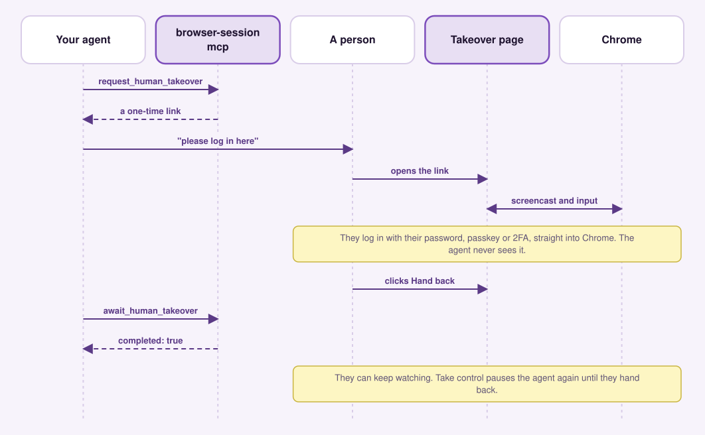
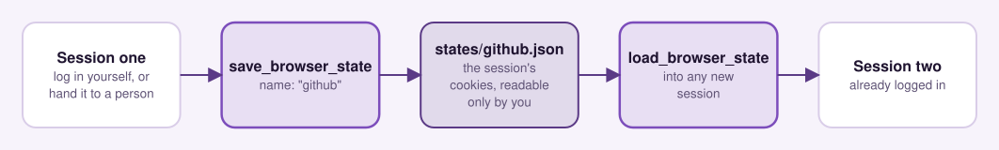

# Workflows

_[← Back to README](../README.md) · [Docs index](README.md)_

Three flows that need more than a single tool call: handing a login to a
human, driving a person's own Chrome through a guest grant, and reusing cookies
across sessions.

- [Human takeover](#human-takeover)
- [Guest grant](#guest-grant)
- [Saved cookie state](#saved-cookie-state)

## Human takeover

When a flow needs credentials the agent must not handle (passwords, passkeys),
hand the live page to a human instead of automating the login:

<!-- diagram:takeover -->
<picture>
  <source media="(prefers-color-scheme: dark)" srcset="diagrams/takeover-dark.svg">
  
</picture>
<!-- /diagram:takeover -->

```ts
const sid = (await tools.browser_session_mcp.open_browser_session({}))
  .structuredContent.sessionId;
await tools.browser_session_mcp.navigate({
  sessionId: sid,
  url: "https://accounts.google.com",
});

// Mint a link and SHOW IT TO THE USER (this call returns immediately).
const { url, token } = (
  await tools.browser_session_mcp.request_human_takeover({ sessionId: sid })
).structuredContent;
// → present `url`; the user opens it, sees a live view of the page, logs in
//   themselves (passkey/password/2FA), and clicks "Hand back". Until then,
//   calls on this session fail with "a person has control".

// Wait for them to finish, ideally in a background task. Each call waits up
// to 25 s by default, under hosts' per-call limits; the person may take
// minutes, so call again until completed (or request a new link if expired):
let r;
do {
  r = (await tools.browser_session_mcp.await_human_takeover({ token })).structuredContent;
} while (!r.completed && !r.expired);
// Now authenticated (r.url says where); continue. A session opened with a
// `name` has already saved this login for next time. If r.watching, the person
// can still see the page and may take control again: a call failing with "a
// person has control" means await the same token again.
await tools.browser_session_mcp.navigate({
  sessionId: sid,
  url: "https://tagmanager.google.com",
});
```

How it works:

1. `request_human_takeover` writes a ticket (sessionId + the active page's CDP
   targetId) to `${STATE_DIR}/takeover/tokens/<token>.json` and returns a link,
   `${TAKEOVER_BASE_URL}/takeover/<token>`.
2. The `browser-session-takeover` daemon serves that page. Its JavaScript opens
   a WebSocket back to the daemon, which relays it to the tab in Chrome (only
   with this link's claim cookie, only for the session's tabs, and only the
   CDP methods the page needs). It streams the live page via
   `Page.startScreencast` and forwards the human's mouse/keyboard as CDP input.
   While the person watches, the relay passes only what shows the page, so
   no click or key reaches Chrome until they take control again. The socket
   closes when the link ends.
3. Chrome's DevTools endpoint stays on loopback, and nothing the human types
   reaches the agent; the daemon only passes CDP messages through.
4. The person starts in control: every tool call on the session, except
   reading logs, fails until they hand back. "Hand back" drops
   `${STATE_DIR}/takeover/released/<token>`, which unblocks
   `await_human_takeover`; "Take control" removes it again.
5. The link ends on "End", when it expires, or a minute after its last open
   page went away; that drops `${STATE_DIR}/takeover/done/<token>`.

Security: the URL is a bearer credential (valid 30 minutes by default, `ttlMinutes` 1 to 60). The first
browser to open it *claims* it via an `HttpOnly` cookie — a leaked URL is
useless once the real user has it, and only the claimant can hand back, take
control or end it.

## Guest grant

A takeover brings a person's login into the operator's Chrome, where the
operator's agent could misuse it once they hand back. A guest grant goes the
other way: the person (the guest) lets the agent drive one tab group in
**their own Chrome**, through a small extension they load themselves. Their
cookies and logins never leave their machine, and every limit on the agent is
enforced by that extension, in their browser, not by this server. The
motivating case: a repo owner clicking through GitHub's settings to install or
configure a GitHub App for you.

```ts
const { url, sessionId } = (
  await tools.browser_session_mcp.request_guest_grant({
    purpose: "Install the deploy bot on acme/api",
    requester: "Ana from ops, via her agent",
    allowedUrlPatterns: [
      "https://github.com/apps/deploy-bot/*",
      "https://github.com/organizations/acme/settings/installations*",
    ],
    startUrl: "https://github.com/apps/deploy-bot/installations/new",
    ttlMinutes: 15, // default 15, at most 60
    approvalMode: "ask", // default: the guest approves every click and Enter
  })
).structuredContent;
// → send `url` to the guest. sessionId is "guest-<token>".

// Once they accept (until then these fail with "hasn't accepted yet"):
await tools.browser_session_mcp.take_snapshot({ sessionId });
await tools.browser_session_mcp.click({ sessionId, selector: 'button "Install"' }); // waits for their Allow
await tools.browser_session_mcp.revoke_guest_grant({ sessionId }); // or let it expire
```

### What the guest installs

The extension is plain JavaScript with no dependencies or build step, in
[`extension/`](../extension); the rules are all in
[`extension/policy.js`](../extension/policy.js), commented for a reader
checking them. It isn't on the Chrome Web Store, so the guest loads it
unpacked:

1. Download the source code zip of a
   [release](https://github.com/xav-ie/browser-session-mcp/releases) (or clone
   the repository at a release tag) and unzip it.
2. Open `chrome://extensions`, turn on **Developer mode**, click **Load
   unpacked**, and choose the `extension` folder.
3. Pin **browser-session guest grant** and click it: it opens in the side
   panel.
4. Paste the grant link and press **Show me what it asks for**.

It asks for `debugger` (to drive the tabs it opens), `tabs`, `tabGroups`,
`webNavigation` (to see where those tabs go), `declarativeNetRequest` (to block
navigations outside the grant), `storage` (its log) and `sidePanel`. It has no
host permissions, no content scripts and no web-accessible resources, so pages
can't see or probe it. It needs Chrome 120 or newer.

### What the guest sees

The side panel shows the grant before anything connects: who is asking and
the purpose (both free text from the operator, marked unverified), the relay
it connects to, the start URL, the allowed URL patterns, the time limit, and
the approval mode, which the guest may change. **Accept** opens an outbound
WebSocket to the relay and the start URL in a new tab, in a purple tab group
named after the purpose. **Decline** tells the relay no.

While it runs, a big banner says **AGENT ACTIVE** with a countdown, and the
panel has **Pause** and **End now**. Chrome shows its own "browser-session
guest grant started debugging this browser" bar; that is expected, and its
Cancel button ends the grant too. In ask mode each click, Enter or Space waits
in the panel (or in a small window, if the panel is closed) showing what is
under the pointer (its role and name from the accessibility tree, with a crop
of the screen around it) or what has focus, and the page URL, with **Allow**
and **Deny**; no answer in 90 seconds is a deny. The **Action log** keeps every
forwarded command (typed text shown only as a length), every denial and every
approval, and exports as JSON.

The grant ends on End now, expiry, closing the tab group or the agent's last
tab, Cancel on Chrome's bar, the operator's `revoke_guest_grant`, or the
connection dropping. The debugger then detaches from every tab and nothing is
forwarded again. The tabs stay, since they are the guest's, and the group is
renamed "Agent gone".

### What the agent can and can't do

With the guest session id, `navigate`, `take_snapshot`, `take_screenshot`,
`click` and `type` work; every other tool fails for it. They act on the agent's
tab (the one the grant opened, or the latest tab opened from it). Selectors are
CSS, or a line from `take_snapshot` such as `link "Configure"` (the name must
match exactly); `jev:` and `navigate`'s `waitUntil`/`text` aren't available.
Snapshots cover the top document only, without iframes or icon hints. In ask
mode a `click` call waits up to 90 seconds for the guest.

The extension enforces, deny by default:

- **Only the agent's tabs.** The debugger attaches only to tabs the grant
  opened and tabs opened from them, inside the group. A tab the guest drags in
  is taken out again; one dragged out stops being the agent's.
- **Only these CDP commands**, each with its parameters rebuilt from known
  fields: `Page.navigate`, `Page.captureScreenshot`, `Page.getLayoutMetrics`,
  `Accessibility.getFullAXTree` and `queryAXTree`, `DOM.getDocument` (root
  only), `DOM.querySelector` (no selectors that test attribute values, which
  could spell out a hidden token), `DOM.scrollIntoViewIfNeeded`,
  `DOM.getBoxModel`, `DOM.focus`, `Input.dispatchMouseEvent` (left button, no
  modifier keys), `Input.dispatchKeyEvent` (no Alt; Ctrl/Meta only for select
  all) and `Input.insertText`. So no `Runtime` (no script, no
  `document.cookie`), no `Network`, `Storage`, `Fetch`, `Target`, `Browser`,
  `Debugger` or `IO`, no downloads or file uploads. `policy.js` says why each
  allowed one can't read cookies or reach outside the tab.
- **Only the grant's URLs.** Every navigation is checked: the agent's own,
  and every redirect, link and history change in its tabs. Chrome's network
  rules block top-level requests outside the patterns before they are sent;
  if a page still ends up outside (a script's `history.pushState`), the agent
  is locked out of that tab until it is back, and hears only its origin.
- **Never these, whatever the grant says**: local and private network
  addresses, and pages for sign-in, passwords, two-factor, security, sessions,
  tokens, keys and billing (GitHub's `/settings/security`, `/settings/tokens`,
  `/settings/keys`, `/settings/billing`, `/settings/applications`,
  `/sessions`, `/login`, repository deploy keys and secrets, and the same words
  as a path segment on any site). The list is data at the top of `policy.js`.

### Residual risk

- Whatever the agent sees does reach the operator: the text and controls of
  the allowed pages and their screenshots. Chrome reports password fields
  masked, but anything else on those pages, the guest shares.
- In auto mode the agent clicks and types as the guest on the allowed pages,
  with no one checking each step.
- The guest trusts the extension code they loaded, so they should load it from
  a release they can check, and keep the patterns narrow.
- The relay (this server's takeover daemon) sees every command and result; it
  can't widen the grant, since the extension only enforces what the guest
  accepted.
- A tab the page opens (a `target=_blank` link) joins the group a moment after
  it starts loading, so its first request can escape the network rules; the
  agent still can't see it until the extension has checked its URL.

How it's wired: `request_guest_grant` writes a ticket to
`${STATE_DIR}/takeover/guest/grants/<token>.json` and returns
`${TAKEOVER_BASE_URL}/guest/<token>`. The takeover daemon serves the grant to
the extension, accepts its WebSocket at `/guest/<token>/ext` (one per grant),
and listens on `${STATE_DIR}/takeover/guest/relay.sock`, which the MCP role
connects to for each tool call, so the MCP role and the daemon need the same
state dir on the same machine, as they already do for takeovers. A grant that
ended is recorded in `guest/ended/<token>` and refuses connections.

## Saved cookie state

The easiest way: open the session with a `name`. While it is open, opening the
same name returns it; after it closes (or Chrome restarts), opening the name
starts a new session with the login saved under it. The login is saved when a
takeover finishes and when the session closes.

```ts
const sid = (await tools.browser_session_mcp.open_browser_session({ name: "github" }))
  .structuredContent.sessionId;
// Log in once (a takeover); every later task opens "github" and is in.
```

By hand, for sites where you don't want to log in every session:

<!-- diagram:saved-state -->
<picture>
  <source media="(prefers-color-scheme: dark)" srcset="diagrams/saved-state-dark.svg">
  
</picture>
<!-- /diagram:saved-state -->

```ts
// Once: log in (interactively or via takeover), then save the cookies
await tools.browser_session_mcp.save_browser_state({ sessionId: sid, name: "github" });

// Later, in any new session:
const sid2 = (await tools.browser_session_mcp.open_browser_session({}))
  .structuredContent.sessionId;
await tools.browser_session_mcp.load_browser_state({ sessionId: sid2, name: "github" });
await tools.browser_session_mcp.navigate({ sessionId: sid2, url: "https://github.com/foo" });
// already logged in
```

Cookies are saved as JSON under `${STATE_DIR}/states/<name>.json` in plaintext (file
mode 0600, dir 0700). v1 is **cookies-only** — localStorage is not yet
supported, but the on-disk schema reserves an `origins[]` field for forward
compat.

---

**Next:** [How it works](how-it-works.md) — the design behind these flows.
