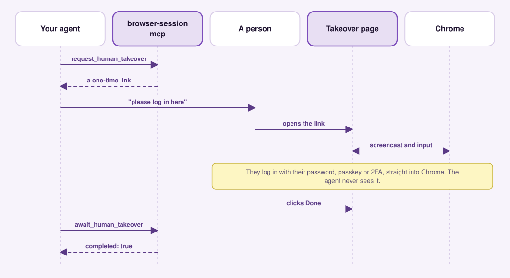
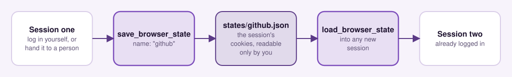

# Workflows

_[← Back to README](../README.md) · [Docs index](README.md)_

Two flows that need more than a single tool call: handing a login to a human,
and reusing cookies across sessions.

- [Human takeover](#human-takeover)
- [Saved cookie state](#saved-cookie-state)

## Human takeover

When a flow needs credentials the agent must not handle (passwords, passkeys),
hand the live page to a human instead of automating the login:

<!-- diagram:takeover -->
<picture>
  <source media="(prefers-color-scheme: dark)" srcset="diagrams/takeover-dark.svg">
  
</picture>
<!-- /diagram:takeover -->

```ts
const sid = (await tools.browser_session_mcp.open_browser_session({}))
  .structuredContent.sessionId;
await tools.browser_session_mcp.navigate({
  sessionId: sid,
  url: "https://accounts.google.com",
});

// Mint a link and SHOW IT TO THE USER (this call returns immediately).
const { url, token } = (
  await tools.browser_session_mcp.request_human_takeover({ sessionId: sid })
).structuredContent;
// → present `url`; the user opens it, sees a live view of the page, logs in
//   themselves (passkey/password/2FA), and clicks "Done".

// Wait for them to finish — IN A BACKGROUND TASK, polling with a short timeout.
// One long await can exceed the MCP client's request timeout (and you'd miss
// the Done signal); the human may take minutes. Poll until completed:
let done = false;
while (!done) {
  done = (
    await tools.browser_session_mcp.await_human_takeover({ token, timeout: 4000 })
  ).structuredContent.completed;
}
// Now authenticated — continue (and optionally save_browser_state to reuse it).
await tools.browser_session_mcp.navigate({
  sessionId: sid,
  url: "https://tagmanager.google.com",
});
```

How it works:

1. `request_human_takeover` writes a ticket (sessionId + the active page's CDP
   targetId) to `${STATE_DIR}/takeover/tokens/<token>.json` and returns a link,
   `${TAKEOVER_BASE_URL}/takeover/<token>`.
2. The `browser-session-takeover` daemon serves that page. Its JavaScript opens
   a WebSocket back to the daemon, which relays it to the tab in Chrome (only
   with this link's claim cookie, only for the session's tabs, and only the
   CDP methods the page needs). It streams the live page via
   `Page.startScreencast` and forwards the human's mouse/keyboard as CDP input.
   The socket closes on Done or when the link expires.
3. Chrome's DevTools endpoint stays on loopback, and nothing the human types
   reaches the agent; the daemon only passes CDP messages through.
4. Clicking "Done" POSTs back and drops `${STATE_DIR}/takeover/done/<token>`, which
   unblocks `await_human_takeover`.

Security: the URL is a bearer credential (valid 30 minutes by default, `ttlMinutes` 1 to 60). The first
browser to open it *claims* it via an `HttpOnly` cookie — a leaked URL is
useless once the real user has it, and only the claimant can click Done.

## Saved cookie state

For sites where you don't want to log in every session:

<!-- diagram:saved-state -->
<picture>
  <source media="(prefers-color-scheme: dark)" srcset="diagrams/saved-state-dark.svg">
  
</picture>
<!-- /diagram:saved-state -->

```ts
// Once: log in (interactively or via takeover), then save the cookies
await tools.browser_session_mcp.save_browser_state({ sessionId: sid, name: "github" });

// Later, in any new session:
const sid2 = (await tools.browser_session_mcp.open_browser_session({}))
  .structuredContent.sessionId;
await tools.browser_session_mcp.load_browser_state({ sessionId: sid2, name: "github" });
await tools.browser_session_mcp.navigate({ sessionId: sid2, url: "https://github.com/foo" });
// already logged in
```

Cookies are saved as JSON under `${STATE_DIR}/states/<name>.json` in plaintext (file
mode 0600, dir 0700). v1 is **cookies-only** — localStorage is not yet
supported, but the on-disk schema reserves an `origins[]` field for forward
compat.

---

**Next:** [How it works](how-it-works.md) — the design behind these flows.
